---

## About Me

I'm **Lê Văn Khoa**, a Software Engineering graduate (2026) from **HUTECH** specializing in **Frontend Development (`React.js`, `Next.js`, `TypeScript`)** with strong algorithmic problem-solving skills (**Top 16 National Olympiad in Informatics**).

Through two internships at **AdsAgency.vn** and **YOOT Edu**, I have built **10+ SEO-optimized, responsive production websites** and **20+ reusable UI components**, integrated **15+ RESTful APIs**, and elevated **Google Lighthouse Performance from 68 to 88+**.

---

## Work Experience

### AdsAgency Vietnam Co., Ltd (`AdsAgency.vn`)
**Web Designer & Frontend Developer Intern** · *07/2026 – 10/2026*
- Designed UI/UX mockups and developed frontend solutions for **10+ corporate websites and campaign landing pages**, ensuring pixel-perfect responsiveness across devices.
- Collaborated directly with **3 enterprise clients** to gather requirements, craft interactive Figma prototypes, and deliver production websites on schedule.
- Optimized web performance (**PageSpeed 85+**) and **On-page SEO** structure to increase conversion rates for Google & Facebook Ads campaigns.

### YOOT Technology and Training Co., Ltd (`YOOT Edu`)
**Frontend Developer Intern** · *04/2026 – 07/2026*
- Engineered and optimized **20+ reusable UI components** across **6 key course modules** using **React.js**, **TypeScript**, and **TailwindCSS**.
- Integrated **15+ RESTful APIs** via **Axios** & **Redux Toolkit**; applied client-side caching to reduce lesson navigation latency by **35%**.
- Resolved **25+ UI defects** across Agile sprints and improved **Google Lighthouse Performance from 68 to 88+**.

---

## Core Stack

### Frontend & UI/UX

### Backend & Tools

---

## Featured Projects

### 1. SmartHire — Online Recruitment & Applicant Management Platform
- **Links:** [Frontend Repo](https://github.com/khoazandev/smart-hire-web) · [Backend Repo](https://github.com/khoazandev/smart-hire-backend) · [Live Demo](https://khoazandev.github.io/smart-hire-web/)
- Built candidate & recruiter portals from Figma designs with **Next.js**, **TypeScript**, and **TailwindCSS**.
- Engineered a drag-and-drop **Kanban pipeline board** and live-preview **CV Builder** (`React Hook Form` + `Zod`).
- Managed global state with **Zustand**, enforced **Role-Based Route Guards**, and integrated **13+ RESTful APIs** via **Axios JWT refresh interceptors**.

### 2. IELTS Mock Test & AI Platform (`IELTS_WEB`)
- **Links:** [Repository](https://github.com/khoazandev/IELTS_WEB) · [Live Demo](https://khoazandev.github.io/IELTS_WEB/)
- Developed a split-pane SPA simulating computer-delivered IELTS exams with **React.js**, **Vite**, **Zustand**, and **TailwindCSS**.
- Integrated **MediaRecorder API** (`getUserMedia`) for browser Speaking recording with real-time waveform visualization, and **Google Gemini AI SDK** for structured JSON Writing Band Score evaluation.
- Eliminated audio playback memory leaks via `useEffect` cleanups and unit-tested scoring logic with **Vitest**.

### 3. Additional Projects
- **Axiom — Enterprise Meeting Protocol**: On-premise enterprise meeting OS built with **Next.js 16**, **FastAPI**, **LiveKit WebRTC**, and **Whisper/Llama-3 AI** ([Repository](https://github.com/khoazandev/Axiom-meeting-protocol)).
- **NovaCart — E-Commerce Frontend Platform**: Modern shopping flow with **React.js**, **Vite**, **Context API + useReducer**, dynamic filtering, checkout validation, and Admin Dashboard ([Repository](https://github.com/khoazandev/NovaCart)).

---

## Honors & Achievements

- 🏆 **Top 16 Nationally** — Vietnam National Olympiad in Informatics for Students, PROCON Division (2025)
- 🏅 **Consolation Prize** — HUTECH PROCON Algorithmic Programming Contest (2025)
- 🏅 **Consolation Prize** — Web & UI/UX Design *"Design Your Future"* — CJ OliveNetworks Vina (2025)
- 🥉 **3rd Prize** — University Individual Programming Contest (2024)

---

## GitHub Stats

---

## Contact

- **Portfolio:** [khoazandev.github.io/khoazandev](https://khoazandev.github.io/khoazandev/)
- **Email:** [levankhoa2004@gmail.com](mailto:levankhoa2004@gmail.com)
- **Phone:** `0766 772 215`
- **LinkedIn:** [linkedin.com/in/khoazandev](https://www.linkedin.com/in/khoazandev)

  

